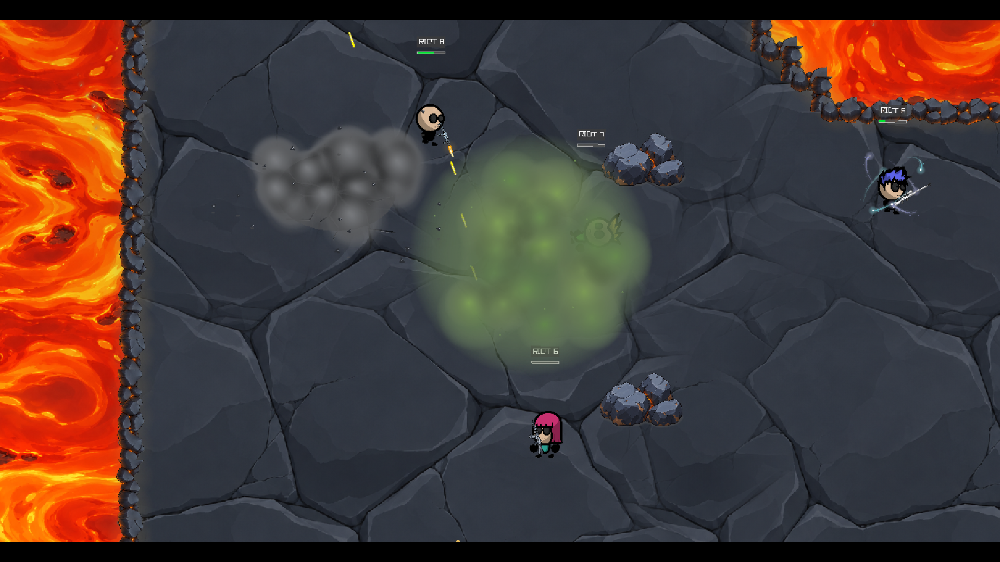

<div align="center">

# VANTA

**Aim. Move. Survive.**

A 2D arena shooter by **R Gamestudio** — built with C++17, raylib, and ENet.

[Gameplay](#gameplay) · [Game modes](#game-modes) · [Controls](#controls) · [Build & run](#build--run)

</div>

## Gameplay

<!-- GAMEPLAY_VIDEO_START -->
[](docs/media/vanta-riot-highlights.mp4)

[Watch / download the gameplay highlights](docs/media/vanta-riot-highlights.mp4)
<!-- GAMEPLAY_VIDEO_END -->

A 66-second highlight featuring the game's original **R Gamestudio → raylib** intro, followed by a 12-fighter offline free-for-all across all three maps. Includes walking, jumps, dashes, grenade blasts, poison smoke, flashbangs, changing camera focus, and zoom transitions. Captured with the native game renderer at 1.12× playback speed, with music and combat audio.

<!-- For GitHub's inline video player, upload docs/media/vanta-riot-highlights.mp4 through GitHub's Markdown editor, then replace the block above with the generated https://github.com/user-attachments/assets/... URL on its own line. See docs/README_VIDEO.md. -->

## Features

- **Offline and online combat:** practice against configurable bots or host and join multiplayer rooms.
- **Movement and defense:** directional dash trails, jumps, and an orbiting shield.
- **Eight guns with skins:** SMG, shotgun, pistol, assault rifle, sniper rifle, AK-style rifle, double-barrel shotgun, and machine pistol. Every gun has its default finish and three alternate skins.
- **Three saved bags:** equip a primary, secondary, melee weapon, frag grenade, poison smoke, and flashbang. Change bags at a base or after respawning.
- **Combat effects:** gray explosive smoke, light flashes, ground cracks, proximity screen shake, and spreading green poison smoke that can damage its thrower.
- **Match HUD:** health, ammo, reload progress, ability cooldowns, equipment slots, and a weapon-icon kill feed.
- **Proximity voice chat:** hold the push-to-talk key during online play.

## Game modes

| Mode | Objective | Respawns |
| --- | --- | --- |
| Training | Warm up without a score limit | Unlimited |
| Free for All | Reach the individual kill target | Outpost respawns |
| Team Deathmatch | Reach the team kill target | Team-base respawns |
| Elimination | Eliminate the opposing team | One life per round |
| Deathmatch / Flag | Carry your team's flag to the enemy base; captures win | Team-base respawns |

Offline setup supports **up to 15 bots**, with **Easy**, **Medium**, and **Difficult** AI. Training can also run without bots.

## Maps

| Arena | Setting |
| --- | --- |
| **Magma Rift** | Basalt cover, stone-edged lava pools, molten effects, and drifting embers. The default arena. |
| **Abandoned Foundry** | Industrial lanes, steel barricades, pipe racks, generators, steam, and sparks. |
| **Desert Outpost** | Sandstone terrain, rock cover, sandbags, vehicles, and windblown dust. |

Maps use editable **Tiled TMX/XML** files in [`assets/Maps`](assets/Maps), with separate visual, collision, spawn, and effect layers.

## Controls

These are the default bindings. Movement, abilities, interaction, and push-to-talk can be rebound in **Settings / F10**.

| Action | Key / input |
| --- | --- |
| Move | `W A S D` or arrow keys |
| Aim / fire | Mouse / left mouse button |
| Jump | `Space` |
| Dash | `Left Shift` |
| Shield | `E` |
| Reload | `R` |
| Primary / secondary / melee | `1` / `2` / `3` |
| Select frag / poison smoke / flashbang | `4` / `5` / `6` |
| Throw frag / poison smoke / flashbang | `G` / `Q` / `T` |
| Flag interaction | `F` |
| Push to talk | Hold `C` |
| Open bag selection | `B` |
| Choose Bag 1 / 2 / 3 | `F1` / `F2` / `F3` |
| Open storage from the setup menus / lobby | `L` |
| Scoreboard | Hold `Tab` |
| Settings | `F10` |
| Pause / back | `Esc` |

Bag changes are restricted to bases and respawns. Changing a bag does not refill ammunition or reset grenade cooldowns. Loadouts, skins, audio settings, and bindings are saved locally in `vanta-settings.cfg`.

## Build & run

The current build targets **64-bit Windows**. Use the **MSYS2 UCRT64** terminal with GCC, CMake, Ninja, raylib, ENet, Opus, and miniaudio installed.

```sh
pacman -S --needed \
  mingw-w64-ucrt-x86_64-gcc \
  mingw-w64-ucrt-x86_64-cmake \
  mingw-w64-ucrt-x86_64-ninja \
  mingw-w64-ucrt-x86_64-pkgconf \
  mingw-w64-ucrt-x86_64-raylib \
  mingw-w64-ucrt-x86_64-enet \
  mingw-w64-ucrt-x86_64-opus \
  mingw-w64-ucrt-x86_64-miniaudio
```

From the repository root:

```sh
cmake -S . -B bin/build -G Ninja -DCMAKE_BUILD_TYPE=Release
cmake --build bin/build -j 4
./bin/build/Vanta.exe
```

Run the executable **from the repository root** so the relative `assets/` paths resolve. If distributing a build, keep the `assets/` directory and required runtime DLLs alongside the executable.

### Offline

Choose **Play Offline**, select a mode and map, set the bot count and difficulty, configure your bags, and deploy.

### Online

One player hosts a room from **Play Online**. Other players join using the host's address. The host chooses the map and mode; players ready up before the match starts. For a local network game, use the LAN address shown in the lobby. Internet connections require the host's game port to be reachable; there is no automatic public matchmaking service.

### Tests

```sh
ctest --test-dir bin/build --output-on-failure
```

The test targets cover match rules and game smoke checks, including loadouts, equipment, map collision, and combat behavior.

## Project layout

```text
assets/       Maps, characters, weapons, equipment, fonts, and audio
src/          Game screens, entities, rendering, networking, voice, and UI
tests/        Match-rule tests and game smoke checks
tools/        Map authoring scripts and native gameplay video capture
docs/media/   README gameplay video and preview
```

## Credits

Created by **R Gamestudio / [@rjltyd](https://github.com/Rexxyd3v)**.

Built with [raylib](https://www.raylib.com/), [ENet](http://enet.bespin.org/), [Opus](https://opus-codec.org/), [miniaudio](https://miniaud.io/), and [raytmx](src/map_loader/raytmx.h). Maps use the [Tiled](https://www.mapeditor.org/) format.
